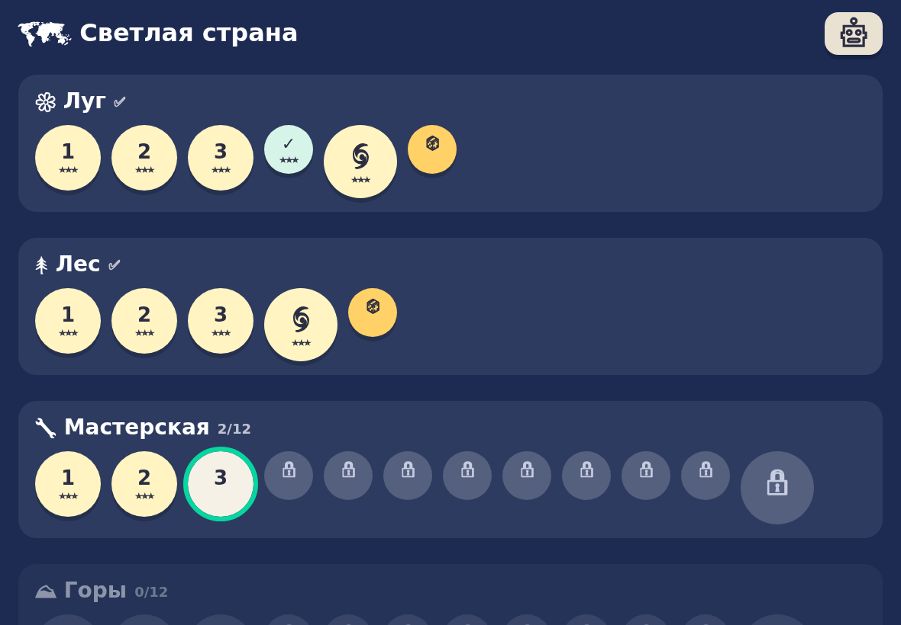
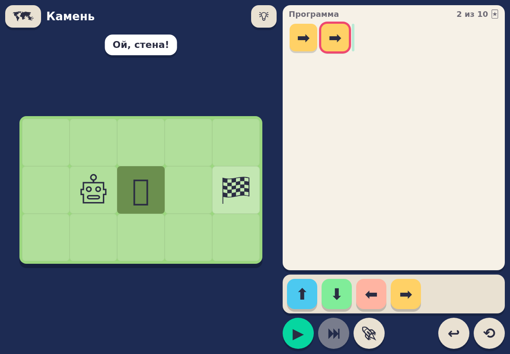
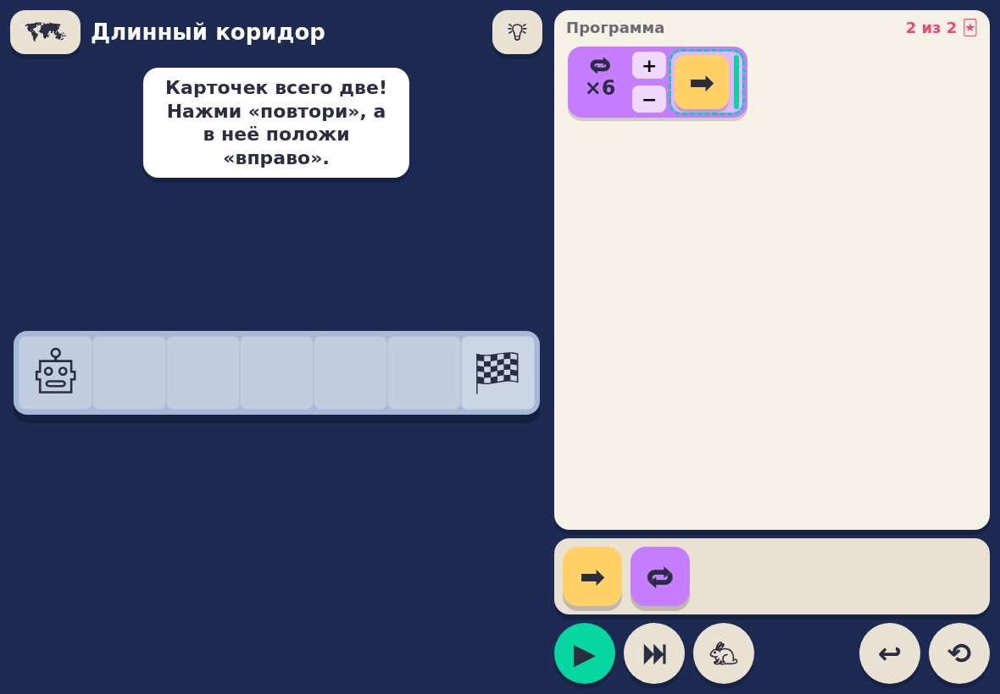
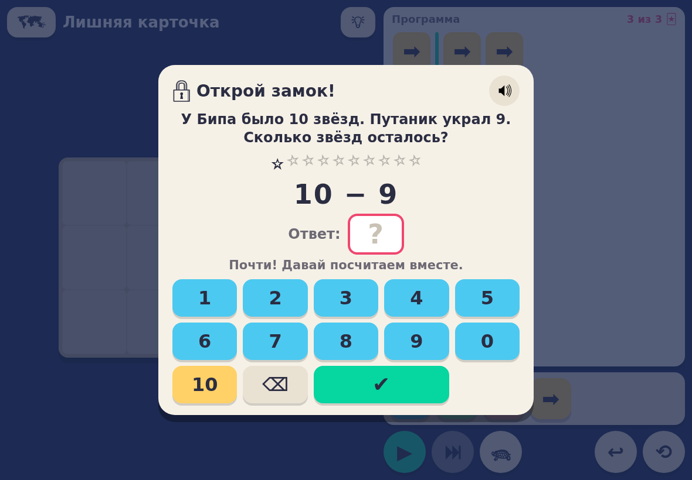

# Путаник 🌀 — игра, которая учит ребёнка думать алгоритмами

Веб-игра для планшета, которая учит детей 6–8 лет основам алгоритмического мышления.
Ребёнок составляет программу из карточек-команд (⬆️ ⬇️ ⬅️ ➡️ 🔁), нажимает ▶ и смотрит,
как герой выполняет её шаг за шагом. Текущая команда подсвечивается, а если герой упёрся
в стену, подсвечивается карточка, на которой всё пошло не так.

Задача игры — не «сделать программиста», а научить **рассуждать**: планировать наперёд,
разбивать задачу на части, проверять своё решение и спокойно искать ошибки.

Проект написан для одного конкретного ребёнка, первоклассника, и подстраивается под него:
сложность уровней меняется автоматически по скорости и точности решения.

<p align="center">
  
  
</p>
<p align="center">
  
  
</p>

> На скриншотах эмодзи чёрно-белые, потому что снимки сделаны в headless-браузере на Linux. На iPad эмодзи цветные.

## Сюжет

Злой **Путаник** перепутал дороги в Светлой стране и спрятал звёзды с неба. Ребёнок выбирает
героя (робот, мальчик, крокодильчик, принцесса или инопланетянин) и помогает ему пройти четыре мира.
Между главами идут короткие озвученные сценки-комиксы. В финале Путаник «распутывается» и становится добрым.

## Чему учит каждая глава

| Глава | Навык | Что делает ребёнок |
|---|---|---|
| 🌼 Луг | Последовательность | Составляет маршрут из стрелок, обходит препятствия |
| 🌲 Лес | Планирование | Собирает все звёзды, сначала берёт ключ, потом идёт к двери, ищет путь короче |
| 🔧 Мастерская | Поиск ошибок | Получает готовую программу, «испорченную» Путаником, и находит, что в ней не так |
| ⛰️ Горы | Циклы | Карточек мало, поэтому нужно увидеть повторяющийся кусок и положить его в «повтори ×N» |

Каждая глава устроена так: **3 вводных уровня**, сделанных вручную, затем **8 уровней из генератора**,
подобранных под ребёнка, затем **уровень-босс**. После прохождения главы открывается бесконечный режим 🎲.

## Педагогические принципы

- **Ошибка — не провал.** Нет таймеров, жизней и «Game Over». Герой мягко останавливается, говорит
  «Ой, стена!», а программа остаётся на месте: можно поправить одну карточку и запустить снова.
- **Отладка по шагам.** Кнопка ⏭ выполняет одну команду за нажатие, так ребёнок сам находит место ошибки.
- **Минимум текста.** Иконки, крупные кнопки и озвучка на русском (Web Speech API). Подходит детям,
  которые только начинают читать.
- **Три звезды за короткое решение.** Это не наказание, а приглашение подумать: «а можно короче?».
- **Тихая помощь.** После 3 неудач появляется подсказка, после 5 — начало решения, после 7 — кнопка
  «другой лабиринт», и следующий уровень будет проще.

## Адаптивная сложность

У каждого навыка своя сложность по шкале от 1 до 20. Цель — чтобы на уровень уходило **примерно одинаковое время**
(по умолчанию 1,5 минуты, родитель может изменить):

- решил быстрее цели — следующий лабиринт больше, со стенами, звёздами, ключами и с меньшим запасом карточек;
- решал долго или с ошибками — следующий проще;
- быстро, но наугад (много неудачных запусков) — сложность не растёт;
- считается только **активное** время: если ребёнок отошёл, часы останавливаются;
- повтор уже пройденных уровней на сложность не влияет.

Генератор (`public/js/engine/generator.js`) строит уровни по сложности и проверяет каждый BFS-решателем.
Уровень всегда проходим, лимит карточек и «эталон» на три звезды точные, а в главе про циклы
без карточки «повтори» уровень не пройти.

## Математический замок

Чтобы перейти к следующему уровню, нужно решить задание на счёт в пределах 10. Ответ набирается
своей клавиатурой (0–10). Есть 11 видов заданий, они открываются по мере роста уровня:

счёт предметов · корзинка (было 4 🍎, положили ещё 3) · улетели (7 🐦, 2 улетели) · пример ·
звёзды героя · домик числа · пропущенное число · числовой ряд · поровну · на сколько больше · два действия.

После ошибки игра не ругает: появляются картинки, которые можно посчитать, а после третьей ошибки
показывается ответ и даётся похожий пример попроще. Уровень заданий (1–5) подстраивается так же, как лабиринты.

## Страница родителя

`/parent` показывает:
- время на уровень, число неудач и подсказок;
- изменение сложности по каждому навыку;
- процент примеров, решённых с первого раза;
- короткий вывод: «легко», «в самый раз» или «трудно».

Там же можно выбрать целевое время, виды заданий, включить или выключить озвучку, сбросить сложность или прогресс.

## Технологии

- **Клиент:** ванильный JavaScript (ES-модули), без сборки и фреймворков. Поле на CSS Grid,
  звуки синтезируются через WebAudio, озвучка через `speechSynthesis`. Можно добавить на экран «Домой» iPad (PWA-манифест).
- **Сервер:** Node.js 20 + Express. Отдаёт статику и хранит прогресс в одном JSON-файле. Авторизации нет:
  игра рассчитана на домашнюю сеть и одного игрока.
- **Тесты:** `node --test`. Проверяются интерпретатор программ, генератор (480 уровней на всех сложностях),
  адаптация, задания по математике (все числа в пределах 0–10) и решаемость всех ручных уровней.

```
server/index.js            HTTP-сервер и API прогресса
public/js/engine/          ядро без DOM: модель уровня, интерпретатор, BFS-решатель,
                           генератор уровней, адаптация, задания по математике
public/js/ui/              экраны: карта, уровень, редактор программы, замок, сценки
public/levels/             сюжет (story.json) и ручные уровни глав (chapterN.json)
public/parent.html         страница родителя
tests/, tools/             тесты и валидатор уровней
```

## Запуск

Нужен Node.js 20+.

```bash
npm install
npm start                  # http://<IP компьютера>:8080, страница родителя — /parent
```

Или через Docker:

```bash
docker compose up -d --build
```

Прогресс хранится в `data/progress.json`, в git он не попадает. Порт задаётся переменной `PORT`,
папка с данными — переменной `DATA_DIR`.

**Автозапуск через systemd** (пользовательский сервис, стартует при загрузке ПК):

```ini
# ~/.config/systemd/user/putanik.service
[Service]
WorkingDirectory=/path/to/Game_for_child
ExecStart=/usr/bin/node server/index.js
Environment=PORT=8080
Restart=always
[Install]
WantedBy=default.target
```

```bash
systemctl --user enable --now putanik
loginctl enable-linger $USER
```

На iPad откройте `http://<IP>:8080` в Safari и выберите «Поделиться → На экран Домой»: игра будет открываться
на весь экран без адресной строки.

## Разработка

```bash
npm test                   # все тесты
npm run check-levels       # отчёт по ручным уровням: решаемость, par, preset
```

### Как добавить свой уровень

Уровни лежат в `public/levels/chapterN.json`, поле задаётся строками:

| Символ | Значение |
|---|---|
| `.` | пол |
| `#` | стена |
| `S` | старт героя |
| `G` | цель (флажок) |
| `*` | звезда (нужно собрать все) |
| `k` | ключ |
| `D` | дверь (открывается ключом) |

```json
{
  "id": "1-06", "chapter": 1, "title": "Камень",
  "grid": [".....", "S.#.G", "....."],
  "commands": ["up", "down", "left", "right"],
  "maxCommands": 10, "par": 6,
  "solution": ["right", "down", "right", "right", "up", "right"],
  "say": "Ой, на дороге камень!", "hint": "Камень нужно обойти: сверху или снизу."
}
```

Поля: `commands` — карточки в палитре, `maxCommands` — лимит карточек, `par` — длина решения на три звезды,
`preset` — готовая «испорченная» программа (для главы про поиск ошибок), `solution` — эталонное решение
(его проверяет валидатор), `say` и `hint` — реплика героя и подсказка по кнопке 💡.

## Что дальше

- Глава «Глазами героя»: команды «шаг вперёд» и «повернись» относительно героя. Интерпретатор их уже поддерживает.
- Глава «Своя команда»: собрать несколько карточек в одну и использовать её повторно.
- Глава «Если…»: условия («если впереди стена — повернись»).
- Нарисованные SVG-спрайты вместо эмодзи.

## Лицензия

MIT
